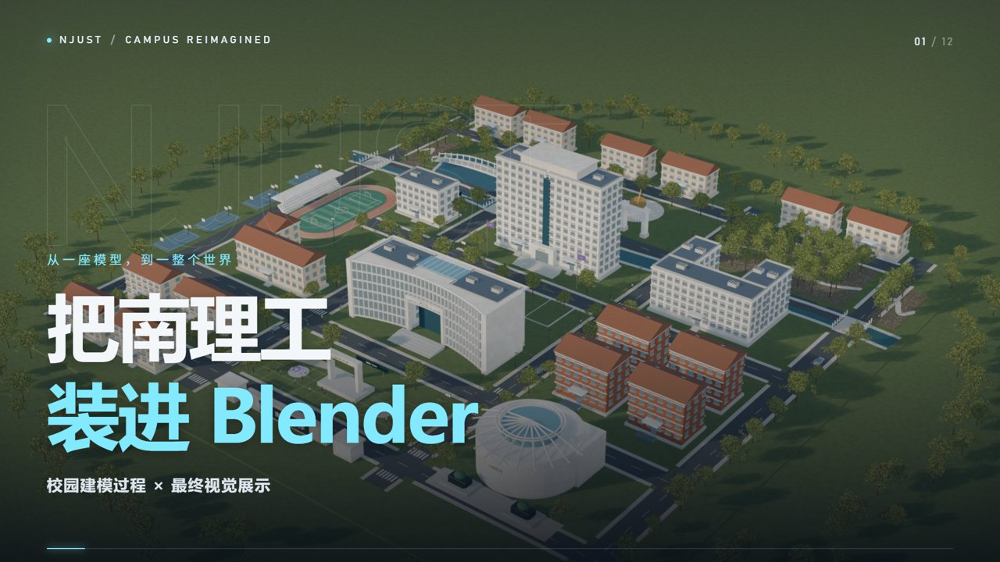

# NJUST Campus — Blender & Film

南京理工大学艺术化校园建模与视频制作工程：从原始模型、精细化升级，到 48 秒横竖双版展示视频。

## 内容

- `njust-miniature/`：初版 Blender 模型与生成脚本。
- `njust-refined/`：最终模型、阶段快照、十张静帧、18 秒漫游与细化脚本。
- `njust-film/`：Remotion / React 剪辑工程、补拍素材、程序合成配乐、48 秒成片及封面。

模型在 Blender 5.1.2 制作；视频使用 Remotion 4.0.529。成片为 30 fps，横版 1920×1080、竖版 1080×1920。模型是艺术化表达，制作过程片段由工程资产重演。

## 使用

直接打开 `njust-refined/NJUST_Final.blend`；详细 Blender 操作见该目录 README。

视频工程：进入 `njust-film`，执行 `npm ci`、`npm run dev`。字体使用本机 Microsoft YaHei / Noto Sans CJK SC 与 Bahnschrift / Arial 回退。安装中文字体后即可预览中文；可在 `src/Shared.tsx` 自定义。系统字体文件不随工程分发。

现有生成脚本保留原制作环境路径 `D:/entertain`，运行前应按本机位置调整；Chrome、Blender、FFmpeg 路径也需相应配置。已渲染视频无需这些依赖即可播放。

## 许可与来源

原创代码适用根目录 MIT LICENSE；该许可不覆盖第三方依赖、字体、校名校徽或参考资料。原创模型几何、视频、渲染图及程序生成配乐适用 CC BY 4.0，详见 ASSET_LICENSE.md。学校标识不代表学校背书。Poly Haven 环境贴图为 CC0，来源见 `njust-refined/修改报告.md`。

## 下载完整工程与成片

Git 仓库存放源码与预览图；[Release v1.0.0](https://github.com/cyd221141/njust-campus-blender/releases/tag/v1.0.0) 提供完整项目压缩包和可直接播放的双版成片。将完整压缩包解压到独立目录即可保留各模块的相对位置。模型发布副本已将文字转为网格并移除内嵌字体；建模脚本仍可用于重新生成文字。

- [B 站横版视频](https://github.com/cyd221141/njust-campus-blender/releases/download/v1.0.0/NJUST_Bilibili_48s_1080p.mp4)
- [抖音竖版视频](https://github.com/cyd221141/njust-campus-blender/releases/download/v1.0.0/NJUST_Douyin_48s_1080p.mp4)
- [完整项目](https://github.com/cyd221141/njust-campus-blender/releases/download/v1.0.0/NJUST_Complete_Project_v1.0.0.7z)

视频制作工作流参考 [Remotion 官方 skills](https://github.com/remotion-dev/skills)。
